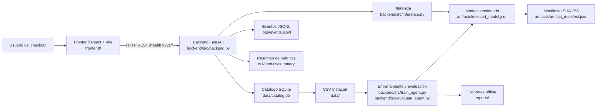
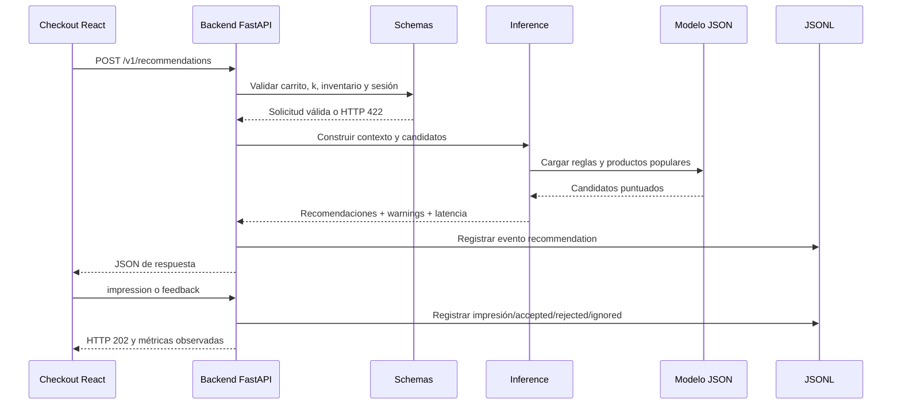

# NEXTCART-AGENT

Agente inteligente de recomendación de productos complementarios y de próxima cesta para un checkout de comercio electrónico.

> **Estado:** prototipo reproducible, explicable y evaluado offline. El repositorio no afirma una conversión comercial del 12 %: ese KPI requiere un experimento A/B con usuarios reales.

## Índice

- [Qué entrega el proyecto](#qué-entrega-el-proyecto)
- [Arquitectura e infraestructura](#arquitectura-e-infraestructura)
- [Estructura del repositorio](#estructura-del-repositorio)
- [Instalación](#instalación)
- [Ejecución rápida](#ejecución-rápida)
- [Flujo de datos y endpoints](#flujo-de-datos-y-endpoints)
- [Logs y evidencias](#logs-y-evidencias)
- [Pruebas](#pruebas)
- [Métricas y alcance](#métricas-y-alcance)
- [Limitaciones](#limitaciones)

## Qué entrega el proyecto

NEXTCART recibe el carrito, navegación, historial reciente, productos rechazados, inventario y el número de recomendaciones solicitado. Genera candidatos con frecuencia global y reglas de coocurrencia, filtra productos no elegibles y devuelve recomendaciones explicables con `product_id`, `score`, `reason`, `source`, `fallback`, `warnings`, `latency_ms` y `model_version`.

El proyecto cubre el ciclo completo:

```text
Auditoría del dataset → entrenamiento offline → evaluación →
artefacto versionado → backend FastAPI → frontend React/Vite →
impresión y feedback → logs y métricas observadas
```

El agente no utiliza LLM. La decisión la toma código Python con reglas de coocurrencia, frecuencia, recompra, disponibilidad y filtros de sesión.

## Arquitectura e infraestructura

### Diagrama de componentes



### Flujo de una recomendación



### Decisiones de infraestructura

| Capa | Tecnología | Responsabilidad |
|---|---|---|
| Interfaz | React, Vite, TypeScript, Chakra UI | Checkout, catálogo, widget, estados de carga/error y feedback. |
| API | FastAPI + Pydantic | Contratos, validación, inferencia, catálogo, eventos y métricas. |
| Modelo | Python, coocurrencia y frecuencia | Generación y puntuación explicable de candidatos. |
| Catálogo | SQLite | Productos, pasillos, departamentos y precios demo deterministas. |
| Persistencia de evidencias | JSON, JSONL y PNG | Modelo, manifiesto, auditorías, métricas, logs y figuras. |
| Ejecución | `uv` + `pnpm` | Entorno Python y entorno frontend reproducibles. |

## Estructura del repositorio

```text
nextcart-agent/
├── README.md                         # guía principal del proyecto
├── backend/                          # todo el backend Python
│   ├── pyproject.toml                # dependencias Python
│   ├── uv.lock                       # bloqueo reproducible de dependencias
│   ├── src/
│   │   ├── backend.py                # aplicación FastAPI y endpoints
│   │   ├── schemas.py                # contratos Pydantic
│   │   ├── inference.py              # carga y recomendación
│   │   ├── train_agent.py             # entrenamiento offline
│   │   ├── evaluate_agent.py          # métricas offline y latencia
│   │   ├── audit_dataset.py           # auditoría S1–S5
│   │   ├── catalog_db.py              # catálogo SQLite
│   │   ├── artifacts.py               # manifiesto y hash SHA-256
│   │   ├── storage.py                 # JSON, JSONL y temporizadores
│   │   └── config.py                  # rutas y configuración
│   └── tests/                         # 44 pruebas backend y fixtures
├── frontend/                          # React/Vite y pruebas Playwright
├── data/                              # CSV Instacart y catalog.db
├── artifacts/                         # modelo y manifiesto
├── reports/                           # métricas, auditoría y figuras
├── logs/                              # eventos JSONL generados por la API
├── notebooks/                         # notebook reproducible de apoyo
└── .github/workflows/ci.yml           # CI backend + frontend + E2E
```

## Instalación

Requisitos recomendados: Python 3.11+, `uv`, Node.js 24+, `pnpm` y Chromium para Playwright.

### Backend

```bash
cd backend
uv sync --extra dev
```

### Frontend

```bash
cd frontend
pnpm install
```

## Ejecución rápida

Abre dos terminales desde la raíz del repositorio.

### Terminal 1 — backend

```bash
cd backend
export NEXTCART_MODEL_PATH=../artifacts/nextcart_model.json
export NEXTCART_EVENTS_PATH=../logs/events.jsonl
uv run uvicorn src.backend:app --host 0.0.0.0 --port 8000
```

En PowerShell:

```powershell
cd backend
$env:NEXTCART_MODEL_PATH = "../artifacts/nextcart_model.json"
$env:NEXTCART_EVENTS_PATH = "../logs/events.jsonl"
uv run uvicorn src.backend:app --host 127.0.0.1 --port 8000
```

La API queda disponible en `http://localhost:8000`. Comprueba el estado:

```bash
curl -s http://localhost:8000/health
```

### Terminal 2 — frontend

```bash
cd frontend
pnpm dev
```

La interfaz queda disponible en `http://localhost:5173`. El proxy de Vite reenvía `/health` y `/v1/*` al backend.

## Flujo de entrenamiento y evaluación

Los comandos Python se ejecutan desde `backend/`. Los resultados se escriben en las carpetas compartidas de la raíz.

```bash
cd backend

# 1. Auditar el dataset
uv run python src/audit_dataset.py \
  --data-dir ../data \
  --output-dir ../reports

# 2. Entrenar el agente
uv run python src/train_agent.py \
  --data-dir ../data \
  --output ../artifacts/nextcart_model.json \
  --metrics-output ../reports/model_metrics.json \
  --seed 42 --min-support 5 --top-k 100

# 3. Evaluar offline
uv run python src/evaluate_agent.py \
  --data-dir ../data \
  --model ../artifacts/nextcart_model.json \
  --output ../reports/model_metrics.json
```

El backend solo carga el artefacto y verifica el manifiesto; no entrena ni descarga datos al arrancar.

## Flujo de datos y endpoints

### Entradas principales

- `session_id`: identificador de sesión.
- `cart`: productos actuales del carrito.
- `navigation`: eventos `view`, `reject` y `cart_add`.
- `recent_history`: cestas anteriores.
- `rejected`: productos rechazados durante la sesión.
- `inventory`: disponibilidad por `product_id`.
- `k`: número de recomendaciones, entre 1 y 10.

### Endpoints

| Método | Ruta | Uso |
|---|---|---|
| `GET` | `/health` | Estado del modelo y del catálogo. |
| `POST` | `/v1/recommendations` | Generar recomendaciones. |
| `GET` | `/v1/catalog/products` | Buscar y paginar productos. |
| `GET` | `/v1/catalog/products/{id}` | Consultar un producto. |
| `GET` | `/v1/catalog/departments` | Listar departamentos. |
| `GET` | `/v1/catalog/aisles` | Listar pasillos. |
| `POST` | `/v1/events/impression` | Registrar recomendaciones mostradas. |
| `POST` | `/v1/events/feedback` | Registrar `accepted`, `rejected` o `ignored`. |
| `GET` | `/v1/metrics/summary` | Consultar métricas observadas y disclaimer A/B. |
| `POST` | `/v1/admin/reload-model` | Recargar modelo con token administrativo. |

### Ejemplo de recomendación

```bash
curl -s -X POST http://localhost:8000/v1/recommendations \
  -H 'Content-Type: application/json' \
  -d '{"session_id":"sess-001","cart":[24852,13176],"rejected":[22935],"inventory":{"21137":true,"22935":false},"k":3}'
```

## Logs y evidencias

Esta tabla conecta cada afirmación de la tarea con el archivo que la respalda.

| Evidencia | Enlace | Qué demuestra |
|---|---|---|
| Log de eventos | [`logs/events.jsonl`](logs/events.jsonl) | Impresiones, recomendaciones y feedback registrados por el backend. |
| Métricas del modelo | [`reports/model_metrics.json`](reports/model_metrics.json) | Precision@K, Recall@K, HitRate@K, MAP@K, cobertura y latencia offline. |
| Auditoría del dataset | [`reports/audit_results.json`](reports/audit_results.json) | Validaciones S1–S5, supuestos, riesgos y decisión de uso del dataset. |
| Informe de auditoría | [`reports/dataset_audit.md`](reports/dataset_audit.md) | Interpretación legible de la auditoría y sus figuras. |
| Figuras de auditoría | [`reports/figures/`](reports/figures/) | Distribuciones, fuga, coocurrencia, tamaño de cesta y composición del split. |
| Modelo versionado | [`artifacts/nextcart_model.json`](artifacts/nextcart_model.json) | Reglas de coocurrencia, productos populares y metadatos de entrenamiento. |
| Manifiesto del modelo | [`artifacts/artifact_manifest.json`](artifacts/artifact_manifest.json) | SHA-256, versión, dataset y trazabilidad del artefacto. |
| Pruebas backend | [`backend/tests/`](backend/tests/) | 44 pruebas de esquemas, inferencia, API, catálogo y pipeline. |
| Pruebas E2E | [`frontend/e2e/`](frontend/e2e/) | Integración contra backend real: recomendaciones, feedback y fallos. |
| CI | [`.github/workflows/ci.yml`](.github/workflows/ci.yml) | Ejecución automatizada de backend, typecheck, build y E2E. |
| Informe académico | [`INFORME_ENTREGA_NEXTCART.md`](INFORME_ENTREGA_NEXTCART.md) | Diseño, matriz, cumplimiento, limitaciones y conclusiones. |

> Los logs JSONL pueden crecer cuando se ejecuta la aplicación. No deben interpretarse como evidencia de conversión comercial sin grupo control, población expuesta y ventana A/B.

## Pruebas

### Backend

```bash
cd backend
uv run pytest -q
```

Resultado de referencia: **44 pruebas aprobadas**.

### Frontend: typecheck y build

```bash
cd frontend
pnpm exec tsc -b
pnpm build
```

### E2E con Playwright

```bash
cd frontend
pnpm exec playwright install chromium
pnpm exec playwright test
```

Resultado de referencia: **8 escenarios aprobados** contra el backend real.

## Métricas y alcance

Las métricas offline se calcularon sobre 131.209 usuarios del split `prior → train` de Instacart:

| Métrica | NEXTCART | Baseline topfreq | Baseline cooccur |
|---|---:|---:|---:|
| Precision@3 | 0,2222 | 0,1076 | 0,1114 |
| Recall@3 | 0,0803 | 0,0322 | 0,0360 |
| HitRate@3 | 0,4890 | 0,2980 | 0,2815 |
| MAP@3 | 0,1788 | 0,0740 | 0,0805 |

La latencia offline reportada es de **2,62 ms de media** y **3,86 ms p95**. La rama actual no implementa un simulador con oracle de productos esperados ni un simulador estocástico de aceptación; por eso la calidad del simulador y la conversión proxy quedan como pendientes, no como valores inventados.

El KPI comercial de aceptación ≥ 12 % requiere un A/B real de dos semanas. Instacart no contiene impresiones, posición del widget, grupo control ni aceptación de usuarios.

## Limitaciones

- El inventario llega como mapa en la solicitud; no hay API real de inventario.
- Los precios son valores de demostración deterministas porque Instacart no contiene precios.
- No hay autenticación ni persistencia de memoria por usuario real.
- Falta reentrenamiento programado con validación y rollback.
- El lint global del frontend conserva errores heredados del template; typecheck, build y E2E pasan.
- La conversión comercial no se puede inferir de Recall@K ni de los logs locales.

## Créditos y documentación complementaria

- Frontend: [`frontend/README.md`](frontend/README.md)
- Backend: [`backend/README.md`](backend/README.md)
- Datos: [`data/README.md`](data/README.md)
- Artefactos: [`artifacts/README.md`](artifacts/README.md)
- Reportes: [`reports/README.md`](reports/README.md)
