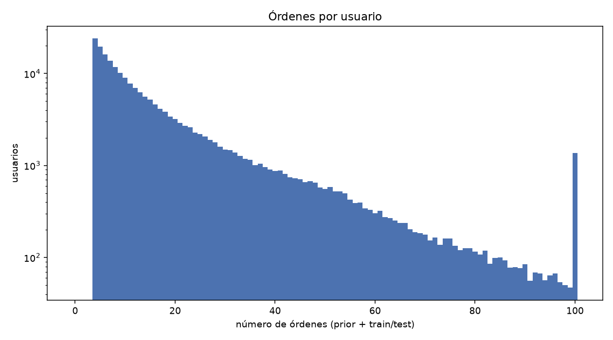
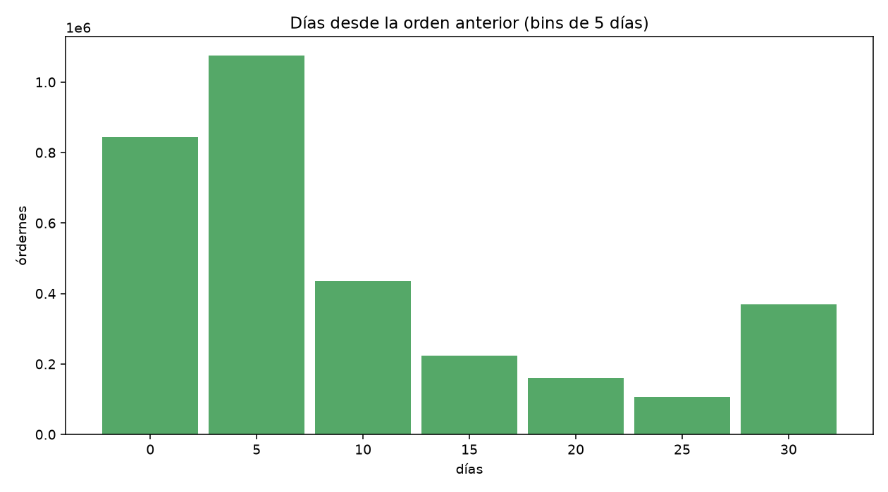
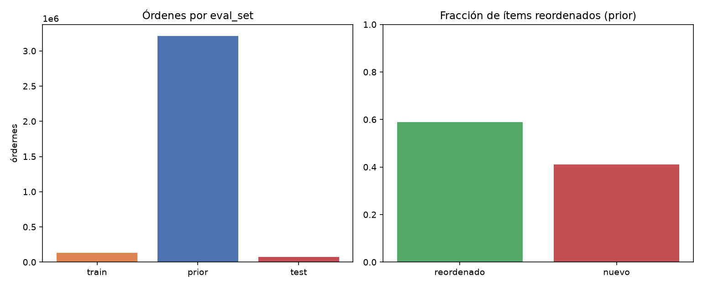
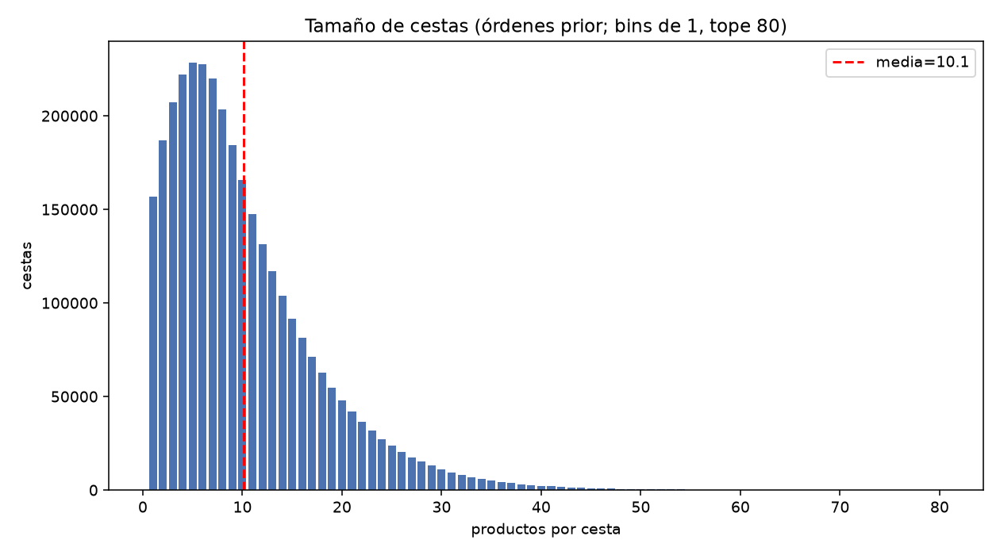
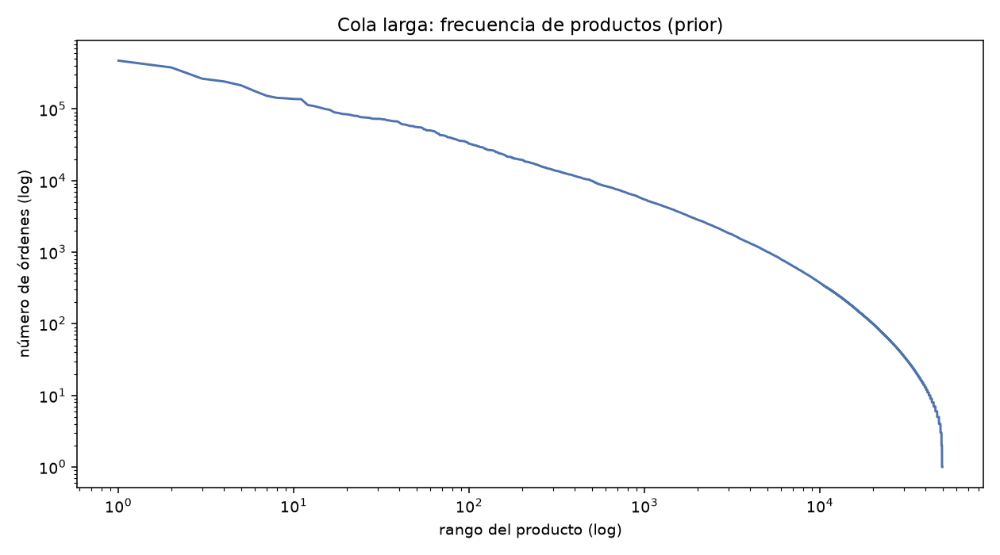
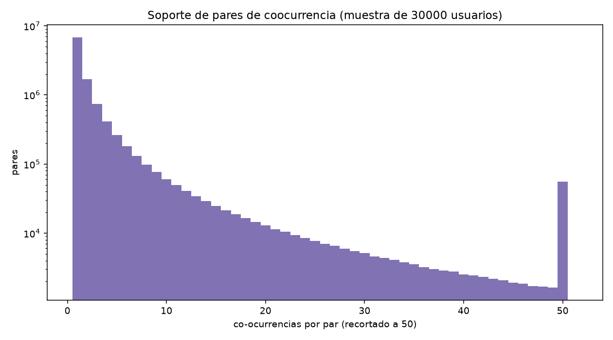
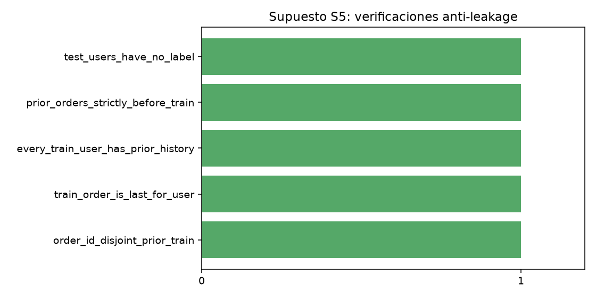

# Auditoría del dataset — NEXTCART-AGENT

**Ejecutado:** 2026-10-18T16:05:49Z · **Semilla:** 42 · **Python:** 3.14.8 · **Plataforma:** Linux x86_64 (equipo local)

**Dataset:** `instacart-online-grocery-basket-analysis-dataset` en `/home/chaos/Projects/universidad/ia/nextcart-agent/dataset`

**Muestreo:** Sin muestreo: se auditan todos los usuarios y órdenes del dataset.

## 1. Resumen de la decisión

- **¿Dataset usable?** Sí
- **Estado:** `usable_with_restrictions`
- **Motivo:** El dataset permite entrenar y evaluar offline un recomendador de próxima cesta con split prior/train libre de leakage. Restricción: no contiene inventario real, precios, posición del widget, impresiones ni aceptación, por lo que los objetivos comerciales (p. ej. 12% de aceptación) solo pueden validarse con un A/B real en producción.

**Acciones requeridas:**
- Entrenar solo con órdenes prior (nunca con la cesta objetivo).
- Filtrar inventario y rechazos en tiempo de inferencia con datos de la tienda.
- Diseñar un A/B de dos semanas con asignación aleatoria para medir aceptación.

**Riesgos:**
- Sin datos de stock real, el filtro de agotados debe venir del sistema de la tienda.
- La coocurrencia captura hábitos históricos de usuarios de 2017 de Instacart; puede no transferirse a otra tienda sin reentrenar.
- La evaluación offline no mide satisfacción ni aceptación de usuario.

## 2. Descripción del dataset

Instacart Online Grocery Basket Analysis reconstruye compras de usuarios de una tienda de comestibles: cada `order_id` es una cesta y `order_number` ordena las compras de cada usuario. El split oficial marca por usuario una última orden `train` (con ground truth público) o `test` (sin ground truth público); todo lo anterior es `prior`.

| Archivo | Filas | Columnas | Bytes |
|---|---:|---|---:|
| orders | 3421083 | 7 | 108968645 |
| order_products_prior | 32434489 | 4 | 577550706 |
| order_products_train | 1384617 | 4 | 24680147 |
| products | 49688 | 4 | 2166953 |
| aisles | 134 | 2 | 2603 |
| departments | 21 | 2 | 270 |

## 3. Método de auditoría

Se ejecutan cinco supuestos sobre los CSV locales con DuckDB (lectura por consultas, límite de memoria 2 GB con volcado a disco). No se modifica el dataset ni se sintetizan filas. Las figuras se guardan en `reports/figures/`. El supuesto S4 usa una muestra de usuarios para el histograma de pares por costo; se documenta en sus métricas.

## 4. Tabla de supuestos

| Supuesto | Descripción | Estado |
|---|---|---|
| S1 schema integrity | Integridad de esquema, claves y referencias | **PASS** |
| S2 sequential history | Historial secuencial reconstruible por usuario | **PASS** |
| S3 basket density | Densidad de cestas y cola larga del catálogo | **PASS** |
| S4 complementarity signal | Señal de coocurrencia y recompra | **PASS** |
| S5 leakage free evaluation | Evaluación sin fuga de información | **PASS** |

## 5. Métricas e interpretación por supuesto

### S1 — Integridad del esquema — PASS

Los seis archivos tienen las columnas requeridas, las claves primarias no presentan duplicados y no hay huérfanos de orden, producto, pasillo o departamento. Los nulos de days_since_prior_order se concentran exclusivamente en la primera compra de cada usuario (206209 nulos), que es el comportamiento esperado: no hay intervalo previo. Esto permite reconstruir cestas y secuencias sin imputación.

**Métricas clave:**

- `column_checks.orders.missing`: []
- `column_checks.orders.pass`: True
- `column_checks.order_products_prior.missing`: []
- `column_checks.order_products_prior.pass`: True
- `column_checks.order_products_train.missing`: []
- `column_checks.order_products_train.pass`: True
- `column_checks.products.missing`: []
- `column_checks.products.pass`: True
- `column_checks.aisles.missing`: []
- `column_checks.aisles.pass`: True
- `column_checks.departments.missing`: []
- `column_checks.departments.pass`: True
- `uniqueness.orders_order_id_duplicates`: 0
- `uniqueness.prior_order_product_duplicates`: 0
- `uniqueness.train_order_product_duplicates`: 0
- `referential.prior_order_id_orphans`: 0
- `referential.train_order_id_orphans`: 0
- `referential.prior_product_id_orphans`: 0
- `referential.train_product_id_orphans`: 0
- `referential.product_aisle_orphans`: 0
- `referential.product_department_orphans`: 0
- `null_counts.orders_null_user_id`: 0
- `null_counts.orders_null_order_number`: 0
- `null_counts.orders_null_days_since_prior`: 206209
- `null_counts.first_order_with_days_since_prior`: 0
- `null_counts.non_first_order_null_days_since_prior`: 0
- `null_counts.orders_total`: 3421083

**Limitaciones:**
- La integridad referencial no valida contenido semántico de nombres de producto.
- order_hour_of_day viene como texto con cero inicial; se convierte con TRY_CAST.

### S2 — Historial secuencial — PASS

Cada usuario tiene su secuencia de órdenes numerada desde 1 sin huecos, lo que permite usar order_number como eje temporal de cestas. Cada usuario eval_set=train/test tiene exactamente una orden final etiquetada y esta es la más reciente, por lo que el split oficial prior→train es coherente con una predicción de próxima cesta sin mezclar futuro. La tasa de reorden de ítems en órdenes prior es 0.590, señal de que la recompra es un componente real del problema.

**Métricas clave:**

- `users_with_order_number_gaps`: 0
- `eval_set_counts.train`: 131209
- `eval_set_counts.prior`: 3214874
- `eval_set_counts.test`: 75000
- `users_with_multiple_non_prior_orders`: 0
- `train_users_with_train_order_not_last`: 0
- `days_since_prior_mean`: 11.114836226863012
- `days_since_prior_median`: 7.0
- `days_since_prior_p90`: 30.0
- `days_since_prior_max`: 30.0
- `users_total`: 206209

**Limitaciones:**
- No hay timestamps absolutos: order_dow/order_hour_of_day y days_since_prior son la única señal temporal disponible.
- La continuidad de order_number no garantiza que la tienda no haya tenido quiebres de stock no observados.

### S3 — Densidad de cestas — PASS

El 95.1% de las cestas prior tienen al menos 2 productos, condición necesaria para estimar coocurrencia. La cesta media tiene 10.1 productos (mediana 8), suficiente para reglas locales sin explodir combinatoriamente. El catálogo es de largo plazo: solo el 20% superior de productos cubre el 91.0% de las filas, por lo que el fallback de popularidad será útil en cold start y el modelo debe combinar reglas (cola) con frecuencia global (cabeza).

**Métricas clave:**

- `prior.n_baskets`: 3214874
- `prior.mean_size`: 10.088883421247614
- `prior.median_size`: 8.0
- `prior.p90_size`: 20.0
- `prior.p99_size`: 35.0
- `prior.max_size`: 145
- `prior.share_baskets_ge_2_items`: 0.951242879192155
- `train.n_baskets`: 131209
- `train.mean_size`: 10.552759338155157
- `train.median_size`: 9.0
- `train.p90_size`: 21.0
- `train.max_size`: 80
- `catalog.distinct_products`: 49688
- `catalog.products_appearing_in_prior`: 49677
- `catalog.coverage_of_catalog_in_prior`: 0.9997786185799388
- `catalog.top20pct_products_share_of_rows`: 0.9097904085986988
- `items_per_user_prior.mean`: 157.28939571017753
- `items_per_user_prior.median`: 83.0
- `items_per_user_prior.p90`: 386.0

**Limitaciones:**
- Instacart no expone stock real: una cesta puede reflejar sustituciones, no la demanda ideal.
- La cola larga implica que miles de productos tendrán pocas o ninguna regla con min_support>=5; el agente debe degradar a popularidad para esos casos.

### S4 — Señal de complementariedad — PASS

La bandera reordered marca el 59.0% de los ítems prior y, definiendo repetición de forma estricta (el producto ya apareció en una compra anterior del mismo usuario), el 88.0% de los ítems de las cestas son repetidos. En la muestra de pares hay 10,948,440 pares distintos y el 11.5% alcanza soporte >= 5, es decir existe masa suficiente para reglas de coocurrencia explicables con min_support=5. El histograma muestra la típica distribución de cola larga: muchos pares raros y una cabeza de pares muy estables que son los que el agente debe explotar.

**Métricas clave:**

- `reorder_flag_rate_prior`: 0.5896974667922161
- `repeat_item_share_in_baskets_sample`: 0.8796299066858738
- `pair_sample.users`: 30000
- `pair_sample.baskets`: 467882
- `pair_sample.products`: 43896
- `pair_sample.distinct_pairs`: 10948440
- `pair_sample.mean_pair_support`: 3.178470357420783
- `pair_sample.max_pair_support`: 9540
- `pair_sample.median_pair_support`: 1.0
- `pair_sample.share_pairs_support_ge_2`: 0.3749012644723815
- `pair_sample.share_pairs_support_ge_5`: 0.11464071593761303

**Limitaciones:**
- El supuesto S4 se calcula sobre una muestra de usuarios (máximo 30000) por costo computacional; se documenta aquí y no afecta al entrenamiento, que sí usa todas las órdenes prior.
- Coocurrencia no implica causalidad ni complementariedad comercial (p. ej. se compran juntos por oferta); solo asocia.

### S5 — Evaluación libre de leakage — PASS

El split oficial esutilizable sin leakage si: (1) los order_id de order_products__prior y order_products__train no se solapan; (2) para cada usuario train, su orden etiquetada es la más reciente; (3) toda orden prior ocurre estrictamente antes; (4) las reglas se entrenan solo con prior y el objetivo (cesta train) nunca entra como variable. Con estas condiciones, evaluar la próxima cesta sobre usuarios train es una estimación honesta del desempeño offline. Los 75k usuarios test no tienen ground truth público y quedan excluidos de la evaluación supervisada.

**Métricas clave:**

- `checks.order_id_disjoint_prior_train`: True
- `checks.train_order_is_last_for_user`: True
- `checks.every_train_user_has_prior_history`: True
- `checks.prior_orders_strictly_before_train`: True
- `checks.test_users_have_no_label`: True
- `train_users`: 131209
- `test_users`: 75000
- `train_order_id_overlap_prior_train_files`: 0

**Limitaciones:**
- No hay impresiones de recomendaciones, exposición ni aceptación en Instacart: el split solo valida precisión de predicción de cesta, no conversión comercial.
- La ausencia de group control impide estimar el lift causal del widget.

## 6. Interpretación de gráficos

Distribución de cuántas órdenes tiene cada usuario (eje Y logarítmico). La cola larga de usuarios habituales sostiene las señales de recompra; la masa de usuarios con pocas órdenes exige un fallback de popularidad.

Intervalo entre compras. Concentración alrededor de ~10–20 días: la próxima cesta es predecible en un horizonte corto; no hay estacionalidad fuerte observable sin timestamps absolutos.

Recuento de órdenes por eval_set (prior domina) y tasa de ítems reordenados. Cerca del 59% de los ítems prior son reordenados:.repeat/explore es una partición real del problema de recomendación.

Histograma del número de productos por cesta (prior). Cestas pequeñas (mediana 8) mantienen barato el conteo de pares y hacen que ~2–3 recomendaciones complementarias sean una cantidad natural.

Frecuencia de productos ordenada (log-log). Marca de cola larga: muchos productos raros. El modelo debe combinar reglas de coocurrencia (explotan la cabeza asociativa) con popularidad global (cubren la cola y el cold start).

Soporte (número de cestas compartidas) de pares de productos en la muestra S4. La masa a la izquierda confirma que la mayoría de pares son raros; la existencia de pares con soporte >= 5 habilita `--min-support 5` con reglas útiles.

Checks booleanos anti-leakage. Todos en verde son condición necesaria para que la evaluación offline sea interpretable.

## 7. Limitaciones del dataset

- Sin precios ni promociones: no se puede optimizar margen ni detectar sesgo por oferta.
- Sin inventario real: el filtro de agotados debe inyectarse en inferencia desde la tienda.
- Sin posición del widget ni impresiones: no hay señal de exposición.
- Sin aceptación ni feedback de usuarios: no hay objetivo de conversión observado.
- Sin timestamps absolutos: la recencia se aproxima con la posición relativa de la orden.

## 8. Riesgos de leakage

- Usar la cesta objetivo (orden train) como variable de features rompería la evaluación; el flujo de NEXTCART entrena exclusivamente con `prior`.
- Mezclar `order_products__train` en el conteo de coocurrencia filtraría el ground truth.
- Los usuarios `test` no tienen cesta objetivo pública: incluirlos en métricas supervisadas sería un error.
- Métricas de repetición calculadas sobre la misma orden que se predice sobreestimarían el acierto (el flujo usa solo el historial previo).

## 9. Recomendaciones de preprocesamiento

- Tratar cada `order_id` como cesta; ordenar productos por `add_to_cart_order` cuando se necesite posición.
- Reconstruir la secuencia con `order_number` (sin huecos, verificado en S2).
- Calcular reglas solo sobre órdenes `prior`; evaluar sobre órdenes `train` de usuarios train.
- Limitar el contexto de historial reciente a los últimos N ítems (default 50) para inferencia rápida.
- Mantener catálogo completo para fallback de popularidad; documentar productos sin reglas.

## 10. Qué se puede afirmar offline

- Si existe señal suficiente de coocurrencia y recompra para entrenar un recomendador explicable de próxima cesta.
- Precision@K / Recall@K / HitRate@K / MAP@K de NEXTCART vs baselines en el split oficial.
- Cobertura del catálogo y latencia de inferencia del artefacto.

## 11. Qué solo puede validarse con usuarios reales

- Tasa de aceptación del widget en producción (objetivo comercial de 12% en A/B de dos semanas): Instacart no contiene impresiones, exposición, grupo control ni aceptación.
- Efecto del inventario real y de la posición del widget en el clic.
- Satisfacción a largo plazo y sesgos de descubrimiento (exploración).

## 12. Conclusión

El dataset **es apto** para entrenar y evaluar offline NEXTCART con las restricciones listadas. El estado es `usable_with_restrictions`: se puede proceder a `python src/train_agent.py` y `python src/evaluate_agent.py` en el equipo local.
